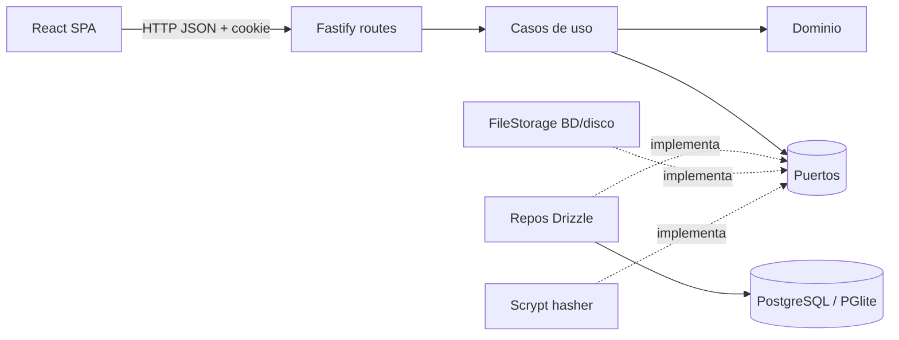
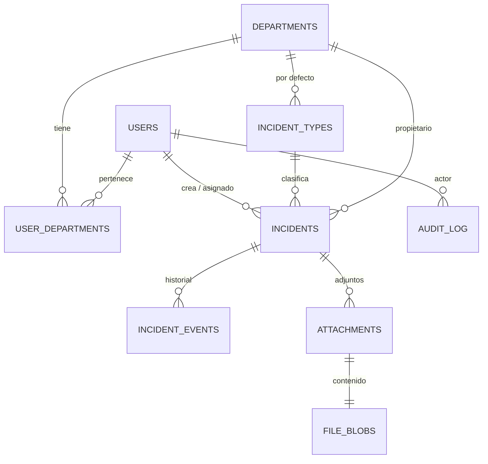
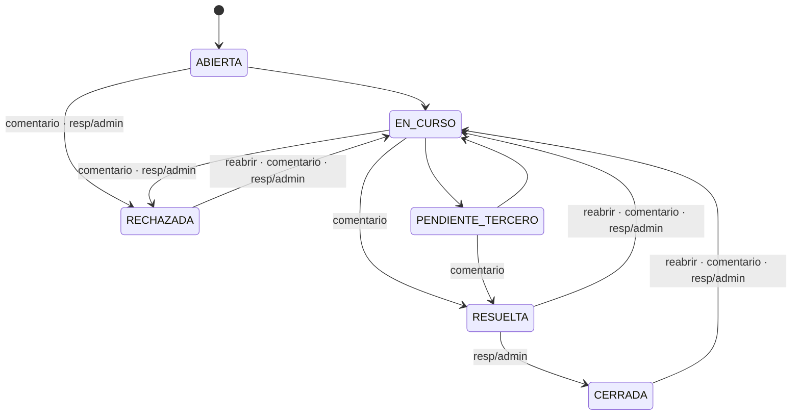

# Spec 02 — Diseño técnico de IncidApp

## 1. Arquitectura

Monolito modular con **Clean Architecture** (ver ADR-0001 y ADR-0002).

```
apps/
├── api/                      Backend (Node + TypeScript + Fastify)
│   └── src/
│       ├── domain/           Reglas de negocio puras: roles, políticas de acceso, máquina de estados, errores
│       ├── application/      Casos de uso + puertos (interfaces) que necesitan
│       ├── infrastructure/   Adaptadores: BD (Drizzle + PostgreSQL/PGlite), hash, almacenamiento, HTTP
│       └── composition/      Composition root: crea adaptadores e inyecta dependencias
└── web/                      Frontend (React + TypeScript + Vite + Tailwind)
```

**Regla de dependencias:** `infrastructure → application → domain`. El dominio no importa nada externo.



## 2. Modelo de datos



- `users` (id, email único, name, password_hash, role, active, created_at)
- `departments` (id, code, name) · `user_departments` (user_id, department_id)
- `incident_types` (id, code, name, default_department_id)
- `incidents` (id, code único, title, description, type_id, department_id, priority, status, third_party, due_date, created_by, assignee_id, created_at, updated_at, resolved_at, closed_at)
- `incident_events` (id, incident_id, actor_id, type, data jsonb, created_at) — tipos: `CREATED`, `UPDATED`, `STATUS_CHANGED`, `ASSIGNED`, `COMMENT`, `ATTACHMENT_ADDED`, `ATTACHMENT_REMOVED`
- `incident_counters` (year, last) — numeración correlativa atómica
- `attachments` (id, incident_id, filename, mime_type, size, storage_key, uploaded_by, created_at) · `file_blobs` (key, data bytea)
- `audit_log` (id, actor_id, action, entity, entity_id, details jsonb, ip, created_at)

## 3. Máquina de estados



## 4. Matriz de permisos

"Ámbito" = la incidencia pertenece a uno de los departamentos del usuario.

| Acción                          | ADMIN           | DIRECCION | RESPONSABLE | USUARIO                                   |
| ------------------------------- | --------------- | --------- | ----------- | ----------------------------------------- |
| Ver incidencia / adjuntos       | Todas           | Todas     | Ámbito      | Ámbito                                    |
| Crear incidencia                | Cualquier dpto. | ✗         | Sus dptos.  | Sus dptos.                                |
| Editar                          | ✓               | ✗         | Ámbito      | Creador y estado `ABIERTA` (sin traslado) |
| Asignar                         | ✓               | ✗         | Ámbito      | ✗                                         |
| Cambiar estado (normal)         | ✓               | ✗         | Ámbito      | Creador o asignado                        |
| Rechazar / Cerrar / Reabrir     | ✓               | ✗         | Ámbito      | ✗                                         |
| Comentar / Adjuntar             | ✓               | ✗         | Ámbito      | Ámbito                                    |
| Borrar adjunto                  | ✓               | ✗         | Ámbito      | Solo los suyos                            |
| Cuadro de mando                 | Global          | Global    | Ámbito      | Ámbito                                    |
| Gestión de usuarios / Auditoría | ✓               | ✗         | ✗           | ✗                                         |

Las operaciones sobre incidencias o adjuntos **fuera de ámbito devuelven 404**; las acciones no permitidas sobre una incidencia visible devuelven 403.

## 5. API REST (prefijo `/api`)

| Método   | Ruta                              | Descripción                                         |
| -------- | --------------------------------- | --------------------------------------------------- |
| POST     | `/auth/login`                     | Inicia sesión (cookie)                              |
| POST     | `/auth/logout`                    | Cierra sesión                                       |
| GET      | `/auth/me`                        | Usuario actual                                      |
| POST     | `/auth/password`                  | Cambiar la propia contraseña                        |
| GET      | `/catalog`                        | Departamentos, tipos, prioridades, estados          |
| GET      | `/users/assignable?departmentId=` | Usuarios asignables de un departamento              |
| GET      | `/incidents`                      | Listado con filtros y paginación                    |
| POST     | `/incidents`                      | Crear                                               |
| GET      | `/incidents/:id`                  | Detalle + eventos + adjuntos + permisos del usuario |
| PATCH    | `/incidents/:id`                  | Editar                                              |
| POST     | `/incidents/:id/status`           | Cambiar estado `{status, comment?}`                 |
| POST     | `/incidents/:id/assign`           | Asignar `{assigneeId \| null}`                      |
| POST     | `/incidents/:id/comments`         | Comentar `{text}`                                   |
| POST     | `/incidents/:id/attachments`      | Subir adjunto (multipart, campo `file`)             |
| GET      | `/attachments/:id`                | Descargar/previsualizar                             |
| DELETE   | `/attachments/:id`                | Borrar adjunto                                      |
| GET      | `/dashboard`                      | Métricas del ámbito                                 |
| GET/POST | `/admin/users`                    | Listar / crear usuarios                             |
| PATCH    | `/admin/users/:id`                | Editar usuario                                      |
| POST     | `/admin/users/:id/password`       | Restablecer contraseña                              |
| GET      | `/admin/audit`                    | Auditoría paginada                                  |
| GET      | `/health`                         | Salud del servicio                                  |

Errores: `{ "error": { "code": "FORBIDDEN", "message": "..." } }` con códigos HTTP 400/401/403/404/409/413/415/429.

## 6. Seguridad (resumen OWASP Top 10)

| Riesgo                             | Medida                                                                                                  |
| ---------------------------------- | ------------------------------------------------------------------------------------------------------- |
| A01 Broken Access Control          | Políticas de dominio evaluadas en cada caso de uso; 404 fuera de ámbito; tests de la matriz de permisos |
| A02 Cryptographic Failures         | `scrypt` con sal aleatoria y comparación en tiempo constante; JWT firmado con secreto de entorno        |
| A03 Injection                      | Consultas parametrizadas (Drizzle); validación con Zod; React escapa la salida                          |
| A04 Insecure Design                | Máquina de estados en dominio; numeración atómica; spec y ADRs                                          |
| A05 Security Misconfiguration      | Helmet (CSP, etc.), cookies `secure`/`httpOnly`/`sameSite`, sin stack traces al cliente                 |
| A07 Identification & Auth Failures | Rate limit de login, mensaje genérico, usuarios desactivables, re-carga del usuario en cada petición    |
| A08 Software & Data Integrity      | Validación de adjuntos por firma de contenido y tamaño máximo                                           |
| A09 Logging & Monitoring           | Tabla de auditoría + logs estructurados (pino)                                                          |
